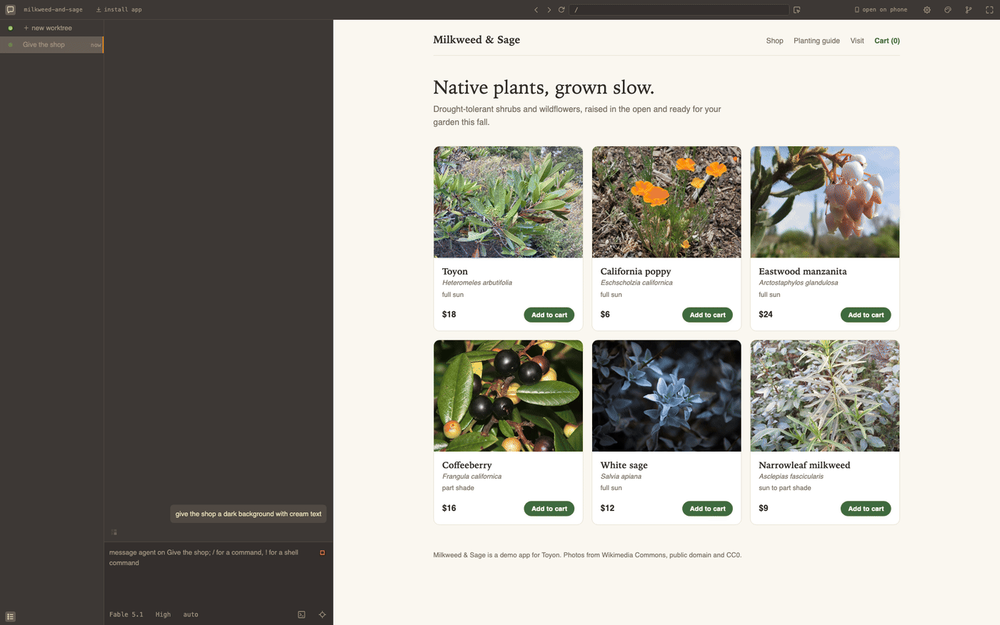

# Toyon

Toyon is where you ask for changes to your web app and try them as they happen. Every chat gets its own running copy with a live preview.

Each copy runs on your own machine, and the next one is pre-warmed. Works with Claude Code, Codex and OpenCode over the Agent Client Protocol (ACP).

[toyon.dev](https://toyon.dev) · [Docs](https://toyon.dev/docs/) · [How it works](#how-it-works) · [Install](#install) · [Under the hood](#under-the-hood) · [Trust](#trust) · [Uninstall](#uninstall) · [Changelog](https://github.com/toyon-dev/toyon/blob/main/CHANGELOG.md)



## Why

A diff says what changed, not whether the page still looks right. A preview link at the end of a run shows you the result after the agent has stopped, too late to steer it. And with more than one agent going it gets worse: terminal splits, copies of the repo made by hand, dev servers fighting over a port.

In Toyon you point at a button in the page and ask for it to be bigger, watch it change while the agent works, and keep the change when it looks right.

## How it works

- Every idea gets its own running copy of your project.
- You judge the work by using the app first, then read the change.
- Watch and steer while it works, or leave and come back to it later.
- Kick off more work or check in remotely from your phone.
- Nothing is kept until you press land.

Each copy is a branch and a git worktree with your dependencies and `.env` files; one spare per project is kept warm.

One rule sits under all of it: no work happens on main. Main has no chat; your first message in a project starts a copy, and the files you have uncommitted in your checkout can move into that copy with it. Your checkout stays where your editor and terminal already are, runs the servers the copies share, and changes only when you press land. Most of what Toyon does without asking follows from that rule: the spare it keeps warm, the copy it starts for a message, the files it carries over, the servers it stops when nobody is looking, and the push it refuses to let an agent make.

Point at anything on the page to talk about it or open the line that draws it, and the design pane maps it to your tokens and components. What the agent is told about the page, and the keys, are in [docs/preview.md](https://github.com/toyon-dev/toyon/blob/main/docs/preview.md).

One Toyon holds every project you open, and the list of chats shows which one needs you.

When your check passes, land merges into main on your machine by default, or pushes, or creates a pull request.

Built for web apps. A project without a page still works; the chat takes the middle instead of the preview.

How to use it is in [docs/using.md](https://github.com/toyon-dev/toyon/blob/main/docs/using.md). Every feature and shortcut is in [docs/features.md](https://github.com/toyon-dev/toyon/blob/main/docs/features.md).

## Install

Try it in a project:

```sh
cd your-project
npx toyon
```

Or install it globally:

```sh
npm i -g toyon
toyon ~/projects/app
```

`toyon .` opens the folder you are in and `toyon --help` lists the rest. The install button in the top bar makes Toyon an app of its own in Chrome, Arc, Brave or Edge, with a Dock icon and no browser bar; from then on `toyon .` opens that. A global install keeps itself updated; `TOYON_UPDATES=off` stops it. Started with npx, Toyon offers the global install above the chat box once it has answered you. Run outside a project, Toyon opens with none: describe a new one in a sentence, or give the project picker a git URL to clone. `toyon https://github.com/you/app` opens it with that repository ready to clone into the folder you are in; a link to a branch, a file or a pull request on GitHub, GitLab or Codeberg is read back to its repository. `toyon send "fix the flaky test"` from a terminal inside a project sends that message into Toyon the way the chat box would: a new worktree from the main checkout, a take-over of a worktree Toyon does not run, or the chat of one it does; an agent running in that terminal can run it too, and `--carry` moves main's uncommitted changes along.

You need:

- macOS or Linux. Windows through WSL2 is not supported yet.
- git and Node 18 or newer. Bun comes with the package.
- An account for the agent you pick: a Claude plan or an Anthropic API key for Claude Code, a ChatGPT plan or an OpenAI API key for Codex, or any provider OpenCode signs into.
- On Linux, bubblewrap and socat for the agents' sandbox (`sudo apt install bubblewrap socat`). `toyon doctor` checks both and prints the AppArmor profile Ubuntu 24.04 and later ask for.

Each agent signs in from the chat. Claude Code and Codex install on first start; OpenCode is a larger download with no subagents, effort levels or steering mid-turn. What each one reads and can do is in [docs/agents.md](https://github.com/toyon-dev/toyon/blob/main/docs/agents.md). Requirements, updating and uninstalling are in [docs/install.md](https://github.com/toyon-dev/toyon/blob/main/docs/install.md), and every command is in [docs/commands.md](https://github.com/toyon-dev/toyon/blob/main/docs/commands.md).

## How is this different from what you use now?

| Coming from | What stays | What changes |
|---|---|---|
| Claude Code or Codex in a terminal | The same agent under your login, with your permission rules, hooks, slash commands and MCP servers | Each chat gets its own copy of the project with the app running, and nothing lands until you press |
| Cursor, Zed or VS Code | Your editor and your checkout; every change lands on disk where your editor already is | The running app is the centre of every chat, wired to its source |
| Lovable, v0 or Bolt | The loop: a chat and the page it changes, and pointing at an element to talk about it | Your own project on your machine, with your database, Docker and private packages; each chat is a branch in your repository |
| Conductor or Superset | Many agents at once, each on its own copy | Built around the app instead of the agents; MIT, no account, no telemetry, lands on your machine without GitHub |

## Under the hood

A `.toyon/settings.json` in the project lists the setup commands, the commands to `run`, an optional `check` and how work lands. Toyon guesses it the first time you open a project. Each `run` command must stay in the foreground and listen on `$PORT`.

A project with a page and an API behind it:

```json
{
  "setup": ["npm install"],
  "run": {
    "web": "vite --port $PORT --strictPort",
    "api": "node --watch server/index.js"
  },
  "check": "npm test",
  "land": { "route": "pr" }
}
```

- Backend commands run once, in the main checkout, and every chat shares them until a chat changes backend files.
- A chat's servers stop when it has not been opened for two hours. The chat and the agent keep running.
- `toyon doctor` reports what is running and why a page cannot connect.

Every setting is in [docs/settings.md](https://github.com/toyon-dev/toyon/blob/main/docs/settings.md). Sharing a backend and a database per chat are in [docs/backends.md](https://github.com/toyon-dev/toyon/blob/main/docs/backends.md).

## What it does not do

- It does not push unless you land with a route that pushes. Agents are told not to push or delete branches.
- It does not give each chat its own database. A database or a compose stack that every chat connects to is shared, migrations included. [docs/backends.md](https://github.com/toyon-dev/toyon/blob/main/docs/backends.md#a-database-per-copy) has recipes for Postgres, Neon, Docker Compose and SQLite.
- It does not carry a login between chats. Each preview has its own cookies, so a new chat's app starts signed out, and an OAuth provider cannot redirect into a preview.

## Your own server

Toyon can also run on a box you open from your phone, or on your own Fly account with the laptop closed. This moves Toyon and its copies off your laptop; it does not publish your app. There is no hosted Toyon service, and your code and keys are never sent to Toyon. `toyon remote` puts a box on your own domain behind Caddy or on your Tailscale tailnet, `toyon deploy fly up` builds a machine on your Fly account and prints the link, and the Dockerfile in the package runs on any host with a disk and a port range. A Fly machine measured about $4-6 a month in ordinary use, plus whatever your agents spend, and its first chat can sign in with your Claude plan. A phone or a second machine pairs by opening the address and being let in from Toyon's window.

These routes are new. How to set each one up, and what it has been checked with, is in [docs/remote.md](https://github.com/toyon-dev/toyon/blob/main/docs/remote.md). Pairing a phone is in [docs/phone.md](https://github.com/toyon-dev/toyon/blob/main/docs/phone.md).

## Disk

Each chat's copy is a git worktree under `~/.toyon/worktrees.noindex`. On APFS, btrfs and XFS it is cloned copy-on-write, so it takes seconds and almost no space. On ext4 each one is a full copy, `node_modules` included. See [docs/using.md](https://github.com/toyon-dev/toyon/blob/main/docs/using.md#disk).

## Trust

Agents run in an OS sandbox, Seatbelt on macOS and bubblewrap on Linux, and can write only inside their copy of the project. Toyon listens on loopback only, and every request carries a per-machine token.

Known gaps:

- `git push` is blocked by a command filter for Claude Code and OpenCode, and is not blocked for Codex. If your git credentials are on the machine, an agent could still find a way to push.
- Codex's shell commands can read Toyon's token.
- MCP servers run outside the sandbox.
- Opening a repository runs its setup commands, its dev server and its agent configuration. Open only repositories you trust.

Each chat has a permission mode: auto, ask or plan. On a company machine, IT can turn features off with a policy file.

The details are in [docs/trust.md](https://github.com/toyon-dev/toyon/blob/main/docs/trust.md) and [docs/policy.md](https://github.com/toyon-dev/toyon/blob/main/docs/policy.md).

## Uninstall

```sh
toyon uninstall
npm uninstall -g toyon
```

`toyon uninstall` asks before it removes anything, and keeps your projects and your `toyon/` branches. Delete a Fly machine first, with `toyon deploy fly destroy <name>`. See [docs/commands.md](https://github.com/toyon-dev/toyon/blob/main/docs/commands.md#toyon-uninstall).

## Telemetry

Toyon sends no telemetry. It checks for updates every six hours. To disable it, use `TOYON_UPDATES=off`. Every request Toyon makes is listed in [docs/trust.md](https://github.com/toyon-dev/toyon/blob/main/docs/trust.md#telemetry).

## Help build it

Toyon is early, and there is more worth doing than there are hands. The most useful thing right now is an issue: what you ran, what broke, and what your project is built with, especially anything that is not a Node app. Pull requests are welcome too; [CONTRIBUTING.md](https://github.com/toyon-dev/toyon/blob/main/CONTRIBUTING.md) has the setup. Run `bun run check` before you open one.

## License

MIT
